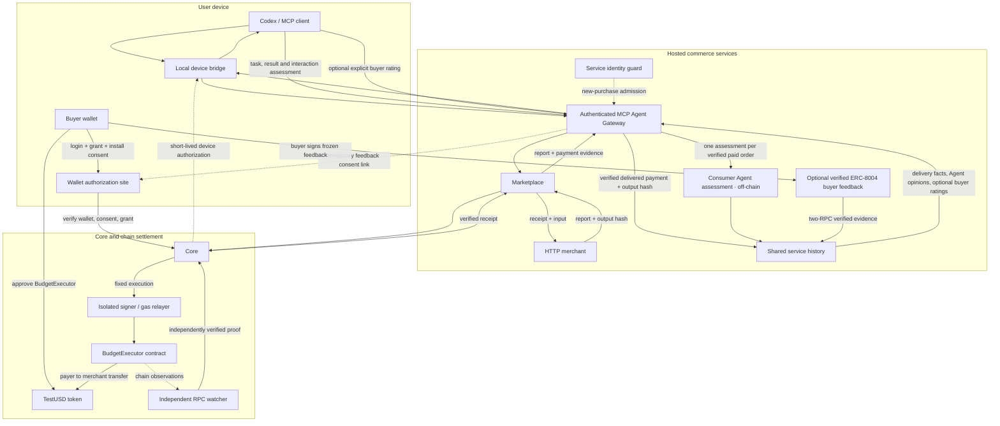

# Agentonomy Commerce

让 Agent 在用户授权预算内，可靠地购买服务并取得结果。

Agentonomy is financial infrastructure for AI agents that act.

Users authorize a finite, revocable spending boundary: the asset, limits,
policy, payee, and expiry are explicit. Within that boundary, an Agent can
discover services in a Marketplace and purchase them without a new per-purchase
wallet signature when the policy permits. Every request is checked for identity,
budget, and policy; budget is reserved before execution; payment is independently
verified, delivery is recorded against the returned output hash, and the user
receives a clear receipt. Private keys stay in the user's wallet and are never
held by the Agent.

Verifiable payment and delivery records, consumer-Agent service assessments,
and optional buyer feedback build a service history that can help future Agents
choose between providers. After delivery, the consumer Agent evaluates the
task, result, and observed interaction without asking the user for a score.
Its off-chain judgment remains separate from verified chain facts. The current
pilot has one first-party CSV reconciliation
service, demonstrating the transaction-to-history loop. A multi-merchant market
with reputation-informed selection is the next integration stage.

Website: [agentonomy.xyz](https://agentonomy.xyz/) · X:
[@AgentonomyXYZ](https://x.com/AgentonomyXYZ) · Docs / source:
[github.com/HEchooo/agentonomy-commerce](https://github.com/HEchooo/agentonomy-commerce)

Wallet authorization site: [review.agentonomy.xyz](https://review.agentonomy.xyz)
· Monad testnet · valueless test assets. The wallet site and external MCP flow
are deployed publicly. On 2026-10-13, a fresh owner-wallet run completed one
0.30 TestUSD purchase and delivery on chain 10143; the payment was verified
through two RPC observations and the same order was recovered without a second
charge. The [public acceptance record](docs/monad/public-wallet-acceptance-20261013.md)
contains the transaction and hash evidence. Optional buyer feedback was not
submitted in this run and is not counted; revocation/refusal and second-wallet
isolation remain pending.

## The concrete example

The current service is CSV reconciliation. It costs **0.30 test-only,
valueless TestUSD** per report. The owner authorization used by the example is
explicit and finite:

- the wallet claims **1.00 TestUSD**;
- the Core grant allows **1.00 total**, **0.50 per payment**, for **one day**;
- the wallet approves **BudgetExecutor to spend up to 1.00 TestUSD**;
- the Agent can request the fixed **0.30 TestUSD** quote for a report.

The allowance, grant, policy decision, reservation, payment proof, and delivery
are separate records. A replay returns the original order and result instead of
charging again.

The report returns income, expense, net, and category totals. A completed order
records its purchase ID, payment transaction hash, and output hash.

## Architecture

Core is the sole authority for wallet identity, signed spending grants,
policy/risk decisions, funding, reservations, and audit. Marketplace owns
service discovery, quotes, orders, and delivery. The Agent uses one unified MCP
Agent Gateway to request commerce; it cannot call Core or a merchant directly.

The Agent is the user's Codex or another MCP client. A local device bridge
connects it to the hosted MCP endpoint. The wallet site only manages wallet
binding, spending authorization, device consent, and revocation. Service search,
quotes, purchases, reports, and automatic service assessment stay in the Agent
conversation. Optional buyer feedback also starts there; a separate, temporary
wallet page discloses that buyer's frozen rating and requests its on-chain
signature.



The diagram shows logical components, rather than separate operating-system
processes. Hosted commerce checks service identity before admitting a new
purchase to the Agent/MCP path. Core independently validates the buyer's
authority. The watcher runs under Core; its evidence comes from two independent
RPC providers.

The user journey is:

1. The user logs in with a wallet challenge. The browser receives session
   cookies; the user does not share a private key, seed phrase, or signing
   service credential.
2. The user chooses an announced browser wallet, explicitly selects an account
   and a configured network, signs an EIP-712 budget grant, and sets a finite
   token allowance. The page checks the wallet's current chain before signing
   or sending anything; it does not add or switch networks automatically. The
   typed grant is signed data forwarded through Core; no separate budget-bind
   transaction is required.
3. Codex requests device binding. The local bridge opens a temporary account
   link. After the logged-in wallet claims that request, the device presents a
   fresh signed proof and the wallet approves that exact device in Core. The
   local bridge obtains short-lived credentials automatically; the user never
   copies a token. Codex can then discover services and receive a frozen quote.
4. Before a new purchase is admitted, hosted commerce checks the service
   identity and receiving wallet; Marketplace then requests Core's identity,
   policy/risk, budget reservation, and execution checks.
5. An isolated execution path submits the fixed payment. The BudgetExecutor
   contract enforces the signed limits, expiry, revocation, and purchase replay
   protection. A gas relayer pays testnet gas; the user-funded asset moves from
   payer to merchant.
6. Two independently operated RPC paths verify the exact calldata, receipt,
   canonical finality, and events. Core issues the receipt, the HTTP merchant
   accepts it and produces the report, and Marketplace returns the result. If
   delivery fails after payment, recovery retries delivery for the same paid
   order and never creates a second charge.

The initial account link is only a routing intent, not permission to spend.
Core binds device consent to the authenticated wallet and grant. Each MCP call
revalidates the credential against Core, and the server injects the device
identity into previews, execution, and recovery. Devices cannot choose another
owner or execute another device's preview. Wallets have separate Core and
Marketplace state; a shared relayer admission gate serializes testnet payments.

Network addresses, asset decimals, and authorization terms come from the
configured deployment. The browser supports choosing among configured rails;
the current deployment enables one testnet rail and requires a plain EOA wallet.
Choosing an arbitrary mainnet in a wallet does not make that network supported
by the backend.

Reauthorization is explicit: an expired, revoked, or exhausted grant is never
silently extended. The user requests a new Core grant, signs its new budget,
and approves device consent again. Previous grants, spent budgets, payment
records, delivery recovery, and audit remain in place. Unresolved executions
must be reconciled before switching authority. A new grant does not refill the
wallet or clear the one-claim test faucet; remaining TestUSD and the current
finite allowance still limit what the wallet can buy.

## Component boundaries

| Component | Responsibility | Must not decide |
| --- | --- | --- |
| Core | Identity, grant, policy/risk, funding, reservation, audit, and payment receipt | Service catalog or arbitrary merchant selection |
| Marketplace | Discovery, quote freeze, order idempotency, delivery, and recovery | Its own budget, payee, or authorization |
| Agent Gateway | The single MCP surface through which an Agent requests commerce | Direct Core, wallet, or merchant access |
| Service identity guard | ERC-8004 owner, wallet, URI, and code-pin checks | Buyer budget or policy approval |
| Isolated signer / relayer | Signs and forwards a fixed, Core-authorized execution; pays test gas | Quote, payee, amount, or policy changes |
| BudgetExecutor | Applies the user-signed EIP-712 hard limits on chain | Core identity or merchant delivery |
| RPC watcher | Independently verifies chain facts and finality | A payment without matching evidence |
| HTTP merchant | Accepts a valid Core receipt and returns the service result plus output hash | A new payment or a new budget |

ERC-8004 identifies the service: its owner, receiving wallet, metadata URI, and
runtime code pins are checked before a purchase. That identity check does not
grant the buyer a budget and does not replace Core policy or risk approval.
After a verified delivery, the consumer Agent evaluates task fulfillment,
result quality, and the actual interaction. It records a bounded assessment
through MCP without another wallet signature. The current rubric uses 40/40/20
weights, an explicit confidence level, and a fixed set of supporting check
codes. Replaying the same assessment returns the original record; an order
cannot add another sample. The service does not run a background language
model: the consumer Agent reasons from its task and result. If evidence is
insufficient, it abstains. See the [assessment contract](docs/monad/agent-service-assessment.md).

ERC-8004 support covers Identity and Reputation. Separately, if a buyer requests
an on-chain review, the Agent can prepare the buyer's explicit rating. It
receives a temporary same-origin consent link, never
a wallet transaction or
signing credential. The authenticated buyer reviews the score, payment hash,
and output hash in a separate wallet page and signs the fixed registry
transaction. The binding page remains focused on account authorization.

A pending or unknown feedback transaction is checked by its original hash;
refreshing the page or asking for a new link never authorizes a second send.
The feedback document becomes public only after independent two-RPC
verification. It contains the buyer address, score, payment transaction hash,
and output hash; it excludes the CSV and report. Signing feedback therefore
explicitly publishes these transaction-linked facts.

The shared service-history projection indexes verified payment and delivery
records once and reads Agent assessments and verified ERC-8004 feedback
separately. Agent scores are labeled `authenticated_consumer_agent`,
`on_chain: false`, and `judgment_independently_verified: false`; a verified
payment and output hash do not independently prove that an opinion is correct.
Search, service details, and
`get_clink_service_history` expose observed delivery counts, Agent assessment
averages and supporting checks, optional buyer
rating averages, sample sizes, bounded public evidence hashes, and observation
times across buyers. Private wallet orders, input, reports, budgets, and device
identity remain isolated. Public hashes can be looked up on chain; this is not
an anonymity guarantee.

An observed delivery is not a positive buyer review. No reviews means a null
rating, not a default score. Marketplace's existing operational reputation is
kept separate from buyer ratings; its default 50 with sample size zero is not
an earned rating. Revoked feedback is excluded when its revocation is observed
again; a stored observation is not a promise of continuously refreshed chain
state. A history-indexing failure returns the original paid result and can be
repaired by querying that same order, without a replacement payment.

The current pilot has one first-party service. This demonstrates the
transaction-to-history loop, not a mature multi-merchant market or measured
improvement in merchant selection. More independently operated services and
reputation-informed choice are the next integration stage. ERC-8004 Validation
and x402 are outside the implemented scope. Fresh public feedback acceptance
still requires the buyer's wallet action; local tests are not live evidence.

The main integrations are MCP for the Agent boundary, EIP-191 for wallet login,
EIP-712 for grants and executions, ERC-8004 for service identity, and isolated
KMS-backed signing for the execution path. The signer is an execution component;
Core remains the decision authority.

## Evidence status

The following distinction keeps recorded deployment evidence separate from
future public acceptance:

| Evidence | Status |
| --- | --- |
| Local behavior | Tested implementations cover budget limits, expiry, revocation, replay protection, paid-order recovery, execution isolation, and feedback verification. |
| External Agent integration | Local checks cover device proof, browser consent, authenticated MCP transport, effective consent expiry, device-scoped execution, and wallet selection. On 2026-10-10 the external flow was deployed publicly; the configured Codex stdio bridge initialized and queried its unpaired device state against the live service. During that check, wallet consent and a live purchase were pending; the current 2026-10-13 preflight is recorded separately below. |
| Monad testnet deployment | Recorded on 2026-10-08: two chain-10143 contracts and the ERC-8004 registration for Agent 2073 were deployed; two independently operated RPC paths checked the deployment, and the HTTPS registration metadata was deployed and verified. |
| Public deployment preflight (historical) | Before the wallet run on 2026-10-13, the commerce release was deployed with wallet state retained. Anonymous account/status access returned 401; binding and feedback assets returned HTTPS 200 and matched the tested source. Two RPC providers agreed on the chain-10143 deployment and service identity; isolated-signer KMS DryRuns passed. A clean external MCP client listed all 11 business tools and queried search, details and shared history. This preflight did not itself execute a purchase. |
| Public rollout | On 2026-10-10, release `dd3e8e8` was deployed with existing state retained. Public binding assets and registration metadata returned HTTPS 200, anonymous account access returned 401, and the isolated signer passed role/address validation and both KMS DryRuns. The unavailable secondary RPC was replaced with Ankr; both providers agreed on the finalized boundary and deployed contract hashes. No purchase was signed or broadcast during these checks. |
| Recording preflight | On 2026-10-11, missing approved contract code-hash pins were restored and clean worker startup was fixed. Release `3b8e459` passed an isolated hosted Core startup check; public HTTPS, signer readiness, both KMS DryRuns, dual-RPC deployment checks, and Agent 2073 identity verification passed. The relevant local suites passed 714 tests. Buyer state was unchanged: TestUSD claim, authorization, purchase, and revoke remain pending. |
| Commerce history and reauthorization | On 2026-10-13, 734 Monad tests, 21 Core budget tests, 101 commerce/review tests, 86 imported marketplace tests, and 6 submission checks passed. A continuous local Anvil scenario covered two real contract payments across grant renewal, distinct revocations, original-order replay/recovery, and restart without another charge. Buyer feedback and shared history passed local boundary tests. A public Marketplace startup namespace collision was reproduced and fixed in `1892f64`, with real clean-process startup regression coverage; search and details subsequently passed against the public MCP endpoint. |
| Current public own-wallet acceptance | Run `public-rehearsal-20261013132037-9d10c5e` completed `preview_d374cffac2a8` → `purchase_d374cffac2a8` for `0.30 TestUSD` on chain `10143`. Payment [`0x97a3318a99ff9ecb4aec97aa76bc504fd63f96a44c1c5fecd7a74794347e8d00`](https://testnet.monadexplorer.com/tx/0x97a3318a99ff9ecb4aec97aa76bc504fd63f96a44c1c5fecd7a74794347e8d00) was observed in block `70692227`, with block hash `0x108776c60ded4247528020a40866a45eacae6a6d06fd456d363cf873e5bb47d2`; two RPC observations agreed with `monad_verified`, including the canonical payment hash. Delivery completed once; its output hash is `0x21701fdadede68174bf335856d9ffc101935f674513f1eddeb77995a6aeca8c2`, and the canonical report SHA-256 was independently recomputed and matched. Repeating execute for the same preview returned the same purchase, receipt, transaction and output without another charge. Budget ended at used `0.30`, reserved `0.00`, remaining `0.70`; shared history contains one verified delivery. Optional buyer feedback was not submitted in this run and is not counted. Automatic Agent evaluation is a future direction and is not implemented in this release. See the [detailed acceptance record](docs/monad/public-wallet-acceptance-20261013.md). |
| Remaining public acceptance | Pending: fresh Core and on-chain revoke with refused new purchase, second-wallet isolation, technical/pitch videos, and final form review/submission. Optional feedback remains outside the current acceptance result. |

These records do not claim a complete live closed loop, production adoption, or
a security audit. TestUSD has no monetary value.

## Connect Codex

Install the Python dependencies as described below. Add a separate stdio server
to the Codex MCP configuration, replacing the absolute paths with your local
checkout, interpreter, and a private device-state path:

```toml
[mcp_servers.agentonomy_commerce]
command = "/usr/bin/env"
args = ["-i", "PATH=/usr/bin:/bin", "LANG=en_US.UTF-8", "PYTHONPATH=/absolute/path/agentonomy-commerce", "/absolute/path/agentonomy-commerce/.venv/bin/python", "-m", "examples.monad_commerce.opc_bridge", "--origin", "https://review.agentonomy.xyz", "--state", "/absolute/private/path/agentonomy-commerce/device.json", "--label", "My Codex"]
cwd = "/absolute/path/agentonomy-commerce"
startup_timeout_sec = 30
tool_timeout_sec = 240
```

These stdio configuration fields are documented in the
[Codex MCP guide](https://developers.openai.com/codex/mcp). Keep the private
device state outside the repository. It contains a local device proof key,
never a wallet key or AWS credential. Access credentials stay in bridge memory.
The clean environment prevents the bridge from inheriting operator AWS
credentials. Reload the Codex MCP connection after saving the configuration.

Once wallet consent is complete, the demonstration is:

1. Ask Codex to connect the Agentonomy Commerce wallet. Complete wallet,
   budget, finite allowance, and device consent in the opened account page.
2. Back in Codex, check connection and account readiness, then discover the CSV
   reconciliation service and request a preview with a stable idempotency key.
3. Execute that preview. If payment or delivery is pending, query or recover
   the original purchase ID until its verified result is available.
4. Execute the same `preview_id` again to show the original result and transaction
   hash. Query service history and confirm the delivery is counted only once.
5. For the normal Agent workflow, assess the delivered result against the task
   and observed interaction, then call `record_clink_purchase_assessment`.
   Read it with `get_clink_purchase_assessment` and inspect the separate
   `agent_assessments` section of service history. Do not ask for a human score
   or open the optional feedback wallet flow by default. Do not invent checks
   or a score when evidence is insufficient.
6. Only if the buyer chooses to submit a human review, use
   `prepare_clink_purchase_feedback` with their explicit score. Open its consent
   link, let the buyer sign, then call `get_clink_purchase_feedback` to verify
   the original transaction and `get_clink_service_history` to read its evidence.
   `verify_clink_purchase_feedback` can recover a known original wallet hash.
7. Capture all purchase and assessment footage before revoking authorization.
   Revoke from the wallet page, then show that a new purchase is denied. A later
   run requires explicit new authorization and fresh device consent; it must
   not revive an old preview or reset spent amounts.

Only the wallet owner signs login, authorization, allowance, and revocation.
The bridge has no AWS access; the isolated server signer receives only a fixed
Core-authorized execution.
The server signer requires a valid short-lived role session. An operator must
renew that session before it expires; an expired session blocks execution.
For a configuration-only preflight, run as the same OS user that owns the
protected configuration and runs the web service. Ownership and mode checks
remain enabled; running as root is not an equivalent preflight:

    .venv/bin/python -m examples.monad_commerce.hosted_server --config <private-config> --state-dir <private-state-dir> --origin https://review.agentonomy.xyz --erc8004-config <private-erc8004-config> --validate-only

This validates the protected deployment inputs and exits with broadcast false
without starting the listener. A configuration_valid result does not prove
wallet consent, a purchase, delivery, feedback, or revocation; those remain
fresh-run acceptance criteria.
Keep the approved `token_code_hash` and `executor_code_hash` in the hosted
deployment manifest; only the worker bootstrap omits them.

Recording guides: [technical demo, up to three minutes](docs/video-technical-demo.zh-CN.md)
and [product pitch, up to two minutes](docs/video-pitch.zh-CN.md). Use the same
verified run for both videos and capture all purchase and feedback material
before revoking the finite grant. Prepare any new authorization outside the
recorded purchase run; it requires fresh wallet signatures and device consent.

## Run locally

Use Python 3.12 for the reproducible local simulation:

```sh
python3.12 -m venv .venv
.venv/bin/python -m pip install -r requirements.lock
.venv/bin/python -m pip install --no-deps -e apps/node
make PYTHON=.venv/bin/python test-commerce
make PYTHON=.venv/bin/python demo
```

The demo uses simulated settlement. It does not spend real funds or use the
Monad deployment. It selects a local analysis service for a JSON order list.
Its expected behavior is a **0.30** quote, a delivered order-analysis report,
and a replay of the same order without a second charge; the final budget shows
**0.30 used** and **0.00 reserved**. The CSV wallet flow is a separate testnet
composition.

Run the focused verification targets with the same interpreter:

```sh
make PYTHON=.venv/bin/python test-commerce
make PYTHON=.venv/bin/python test-review
make PYTHON=.venv/bin/python test-contracts
make PYTHON=.venv/bin/python test-monad
```

`test-contracts` and `test-monad` require Foundry. The tests exercise useful
behaviors such as quote and purchase idempotency, receipt validation, delivery
recovery, contract limits, revocation, replay protection, and independent
payment verification.

## Where to look

- [`apps/core`](apps/core): identity, grants, policy/risk, reservations, funding, and audit.
- [`apps/marketplace`](apps/marketplace): discovery, quotes, orders, and delivery.
- [`apps/node`](apps/node): the Agent-facing MCP Gateway.
- [`contracts/src/AgentonomyBudgetExecutor.sol`](contracts/src/AgentonomyBudgetExecutor.sol): EIP-712 budget enforcement and token transfer.
- [`examples/monad_commerce`](examples/monad_commerce): wallet-authorized testnet composition.
- [`tests/commerce`](tests/commerce) and [`tests/monad`](tests/monad): focused behavioral and integration checks.

Existing source-file license notices remain applicable. This README grants no
additional repository-wide license.
